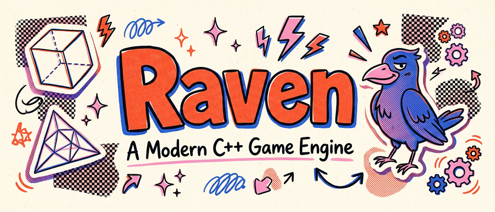

# 🐦‍⬛ Raven

Raven is a modern C++23 game engine, built with a focus on performance and fidelity.

## ❗ Disclaimer

This is a work in progress portfolio project and is not intended for production use. The engine is still under development and may contain bugs, incomplete features, and other issues. Production use is not a priority at this time, but is something that may be considered in the future. The engine is being developed for personal use and learning purposes, and is not intended to be used in any commercial or production environment. Though I am still open for contributions.

## 🤖 Usage of AI

The Raven Engine project follows a strict no-AI generation policy. All code contributions must be written by humans and should not be generated by AI tools. AI can be used as a tool for research, planning and asking questions, but it should not be used to generate any form of code, including but not limited to source code, scripts, configuration files or documentation.